# 架构与 IO 图集（Mermaid 原版）

**新版入口：[Archify 交互图集](archify/index.html)**。原版保留作对照；blob/PWL 和双层 GC 的精确边界以重绘版及更新文档为准。

图源基于当前源码；可选能力不代表默认开启，流程细节以配套文档为准。

## 01 系统与进程边界

[独立图源](01-system.mmd)

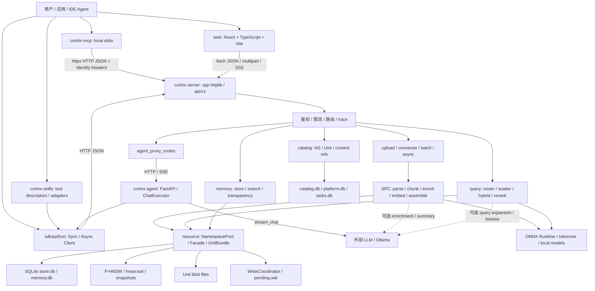

## 02 启动与关闭

[独立图源](02-bootstrap.mmd)

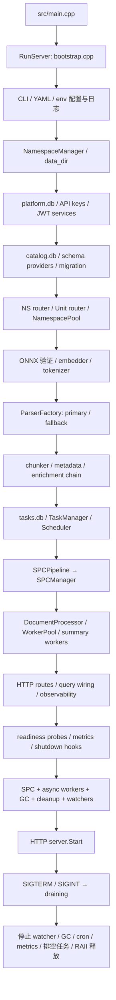

## 03 文档入库流水线

[独立图源](03-ingest.mmd)

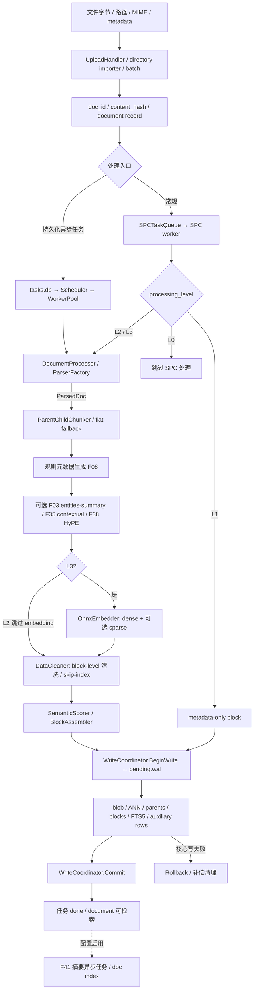

## 04 查询召回与融合

[独立图源](04-query.mmd)

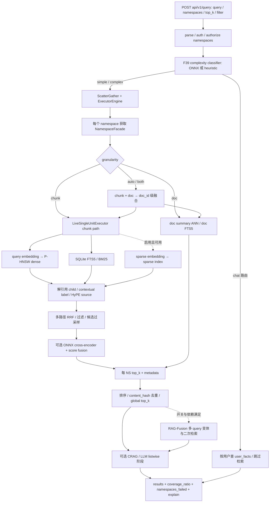

## 05 跨命名空间查询时序

[独立图源](05-query-sequence.mmd)

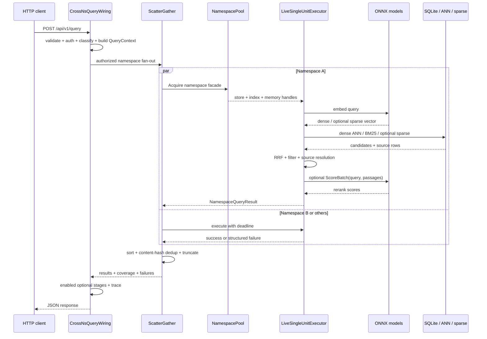

## 06 物理存储与逻辑资源

[独立图源](06-storage.mmd)

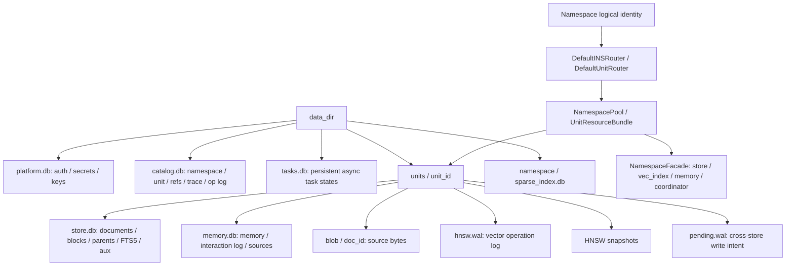

## 07 跨存储写入与崩溃恢复

[独立图源](07-write-recovery.mmd)

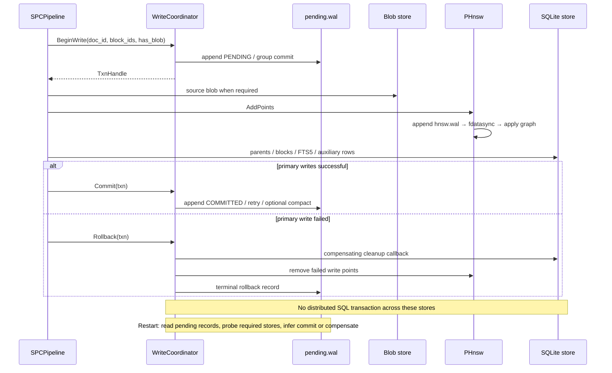

## 08 持久化异步任务

[独立图源](08-async.mmd)

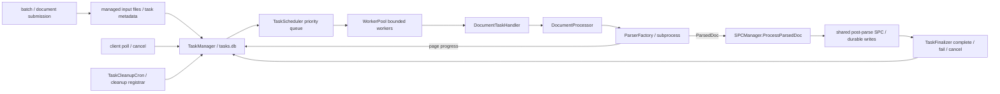

## 09 固定 RAG Agent 时序

[独立图源](09-agent.mmd)

```mermaid
sequenceDiagram
  participant U as Web / client
  participant C as C++ agent proxy
  participant A as FastAPI chat route
  participant E as ChatExecutor
  participant S as Python SDK / Cortrix query
  participant L as configured LLM adapter
  U->>C: chat request
  C->>A: forward HTTP
  A->>A: session history / context
  A->>E: execute(message, context)
  E->>S: retrieve relevant chunks
  S-->>E: chunks / sources / meta
  Note over E,S: retrieval retry up to 3 attempts; exhaustion degrades to no-context prompt
  E->>S: best-effort document inventory
  E->>E: build prompt + sources + recent history
  E->>L: stream_chat
  L-->>E: text pieces
  E-->>A: StreamEvent chunk / terminal meta
  A-->>C: SSE data frames + DONE
  C-->>U: streamed response
  Note over A: SessionStore is in-process memory, not durable storage
```

## 10 MCP、SDK 与 Skills

[独立图源](10-mcp-sdk.mmd)

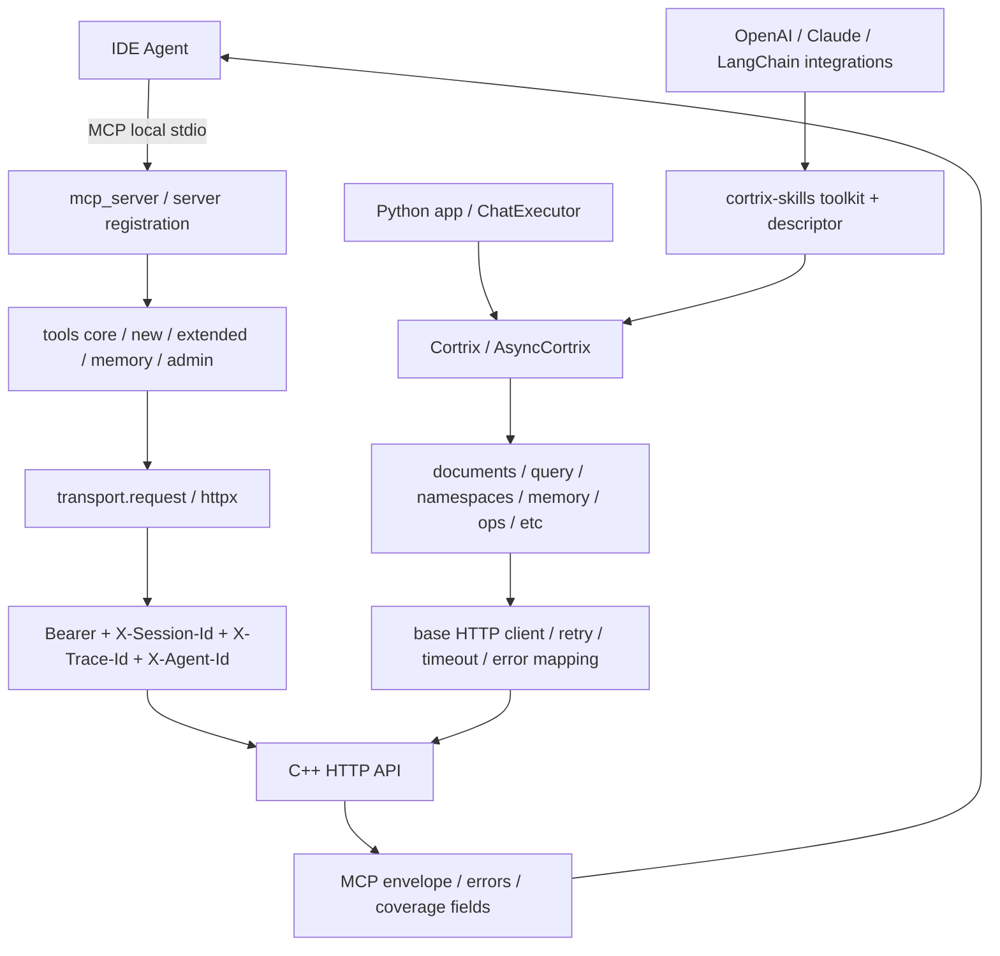

## 11 可观测性与健康检查

[独立图源](11-observability.mmd)

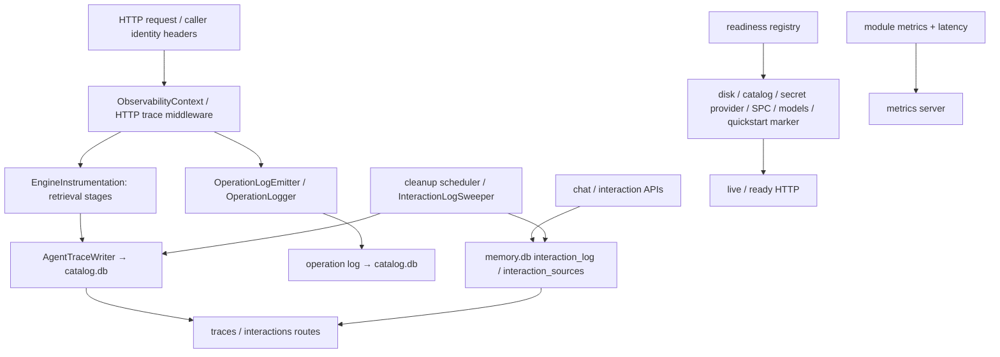

## 12 删除与 GC

[独立图源](12-delete-gc.mmd)

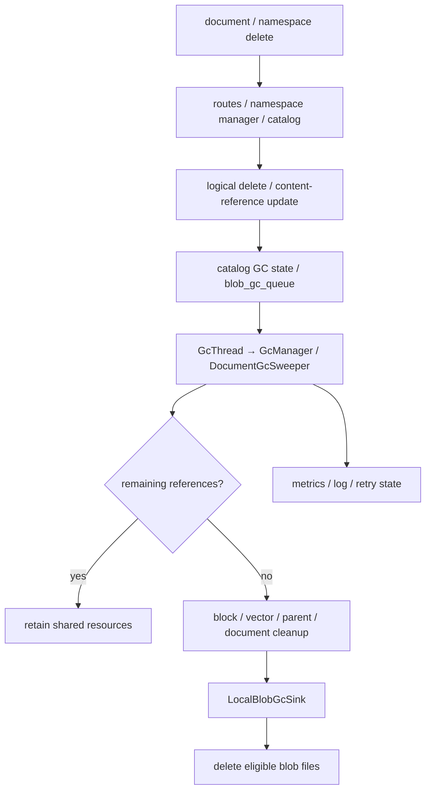
